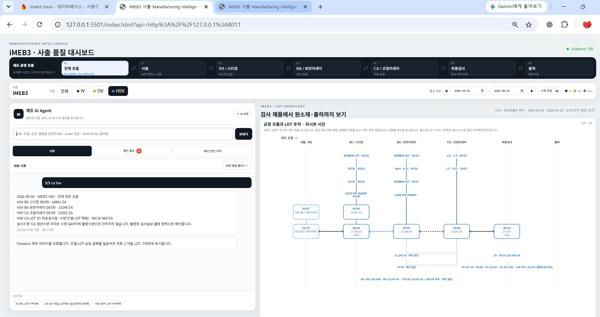
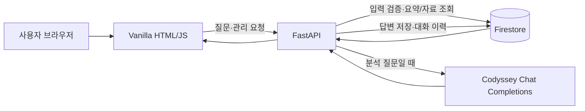

# iMEB3 제조 품질 AI Agent — 과제 제출용 v0.50.0

기존 iMEB3 v0.48 Manufacturing Intelligence를 과제 필수 요구사항에 맞게 완성한 버전입니다.
공개/평가 환경에서는 실제 회사 원본 대신 `POST /api/data/seed-demo`가 생성하는 **비식별 DEMO DATA 120건**을 사용합니다.

## 배포 주소

- 프론트엔드: [https://m1-2-frontend-dun.vercel.app](https://m1-2-frontend-dun.vercel.app)
- 백엔드 API: [https://imeb3-ai-agent-api.onrender.com](https://imeb3-ai-agent-api.onrender.com)
- Swagger: [https://imeb3-ai-agent-api.onrender.com/docs](https://imeb3-ai-agent-api.onrender.com/docs)
- 관리 화면: [https://m1-2-frontend-dun.vercel.app/manage.html](https://m1-2-frontend-dun.vercel.app/manage.html)
- 시연 전 Render 사전 준비 페이지: `frontend/warmup.html` (다음 Vercel 배포 이후 `https://m1-2-frontend-dun.vercel.app/warmup.html`)

2026-10-24 Firebase Console에서 Firestore “일일 사용량 한도를 초과했습니다” 상태를 확인했습니다. 이후 브라우저 실호출에서 Render health는 `storage=firestore`로 정상 응답했고 Swagger도 열렸지만, `/api/data/summary`는 “Firestore 조회가 제한됐고 지정된 CSV 임시자료를 찾을 수 없습니다”라는 앱 오류를 반환했습니다. 첫 요청에는 Render 무료 인스턴스의 cold start 화면과 기동 대기가 있었습니다. 터미널의 소켓 권한 오류는 해당 실행환경의 외부 연결 제한이며 Render HTTP 오류가 아닙니다. 할당량 초기화 후 데이터 조회와 관리화면 CRUD를 재검증해야 합니다. 이전 배포 점검에서는 Firestore 1,086건/요약 대상 250건, 저장된 대화 재조회와 Codyssey 추가 분석 응답을 확인했고, 시연용 임시 자료는 삭제해 기준 건수를 복구했습니다. 출력 토큰 한도는 앱 프롬프트에서 500일 때 응답이 `finish_reason=length`로 잘려 2,000으로 설정되어 있습니다. 과거 모델 오류 기록은 2026-10-20 점검 당시의 결과이며 현재 성공 호출 결과와 구분해 읽어야 합니다.

2026-10-24 추가 코드 변경: Render 사전 깨우기 페이지와 Firestore 일일 `data` 스냅샷·7일 보관·누락 문서 복구 도구를 로컬 코드에 반영했습니다. **아직 Render/Vercel에 배포되지 않았으므로 운영 서비스에는 적용 전입니다.**

로컬 `firestore_import` 백업의 읽기 전용 대체 경로는 2026-10-24 점검에서 CSV 변경자료 720건(생산량 요약 대상 187건)을 반환했습니다. 이는 Firestore 전체 스냅샷이 아니며 배포 서비스에는 포함되어 있지 않으므로, 배포 CRUD 검증이나 Firestore 전체 데이터 증빙으로 사용하지 않습니다.

## 과제 화면 캡처

### 2026-09-09 HSV 제조 흐름 질문

로컬 CSV 임시자료에서 `9/9 CA HSV` 질문으로 확인한 화면입니다. 답변과 그래프에 표시된 데이터는 CSV 임시자료 기반이며, Firestore 배포 연결의 증빙은 아닙니다.



### 제출 상태와 남은 확인

| 항목 | 현재 제출 자료 | 보완 상태 |
|---|---|---|
| 제조 질문·답변 및 LOT 그래프 | 위 로컬 화면 캡처 | CSV 임시자료 기반임을 캡션과 화면에 표시. Firestore 배포 증거로 사용하지 않음 |
| Render/Vercel 배포 및 Codyssey 호출 | 이전 배포 점검 기록과 위 서비스 주소 | 2026-10-24 Firestore 일일 한도 초과로 현재 배포 데이터 API 재호출은 대기 |
| 데이터 추가·수정·삭제 | 코드와 이전 API 검증 기록 | 실제 관리 화면 수정·삭제 시연 및 캡처는 Firestore 복구 후 보완 |
| 대화 불러오기 | 이전 배포 점검 기록 | 최신 제출용 화면 캡처는 Firestore 복구 후 보완 |
| 좁은 화면 사용성 | 해당 없음 | 제출 전 별도 확인 |

Firestore 할당량 복구 후 `manage.html`에서 임시 데이터 1건을 추가·수정·삭제하고 기준 건수 복구를 확인합니다. 이어서 배포 채팅 답변과 저장 대화 재조회 화면을 캡처합니다. 파일은 각각 `docs/screenshots/data-crud.jpg`, `docs/screenshots/conversation-load.jpg` 및 `docs/screenshots/chat-firestore.jpg`로 저장합니다. 현재 캡처 파일은 로컬 CSV 자료를 사용한 결과이므로 제출 시 데이터 출처를 함께 설명합니다.

## 구현 기능

- 데이터 기반 AI 채팅: `POST /api/chat`
  - Firestore/Memory의 관련 데이터 조회
  - `/api/data/summary`와 관련 데이터 Context 주입
  - `OPENAI_API_KEY`와 Codyssey API 주소가 있으면 Codyssey Chat Completions API 사용
  - 키가 없거나 AI 호출 실패 시 Evidence 기반 fallback (없는 값 생성 금지)
  - 대화 자동 저장
- 데이터 CRUD
  - `POST /api/data`
  - `GET /api/data`
  - `PUT /api/data/{id}`
  - `DELETE /api/data/{id}`
  - `GET /api/data/summary`
- 대화 기록
  - `POST /api/conversations`
  - `GET /api/conversations`
  - `GET /api/conversations/{id}`
  - `DELETE /api/conversations/{id}`
- Firestore Adapter + 로컬 Memory fallback
- FastAPI Swagger `/docs`
- Vanilla HTML/CSS/JavaScript Frontend
- 기존 iMEB3 제조 Dashboard
- 데이터 CRUD / Summary / Conversation 관리 화면 (`manage.html`)
- Render / Vercel 배포 설정
- Render 시연 사전 기동 페이지 (`warmup.html`)
- Firestore 조회 성공 후 하루 1회 `data` 컬렉션 백업 스냅샷 (`daily_backups`, 기본 최근 7일)

## 과제 발표용 동작 설명



- 사용자는 자연어로 제조 데이터를 질문하거나 관리 화면에서 기록을 다룹니다. 브라우저는 FastAPI에 요청하고, FastAPI가 Firestore에서 요약과 질문 관련 기록을 가져와 답변 근거로 사용합니다.
- Pydantic 요청 모델은 날짜 형식, 숫자, 제품 variant 등 입력을 서버 저장 전에 검사해 잘못된 값이 DB로 들어가는 것을 막습니다.
- Codyssey는 분석이 필요한 질문에만 추가 호출합니다. 서버는 제조 데이터 요약과 관련 근거를 함께 전달하며, 응답이 실패하면 근거 기반 대체 답변을 반환하고 실제 공급자 상태를 구분해 기록합니다.
- 질문과 답변은 `conversations`에 저장되어 관리 화면에서 대화를 선택하면 상세 API로 메시지를 다시 불러옵니다. `data`, `conversations`, `reviews`는 각각 Firestore 컬렉션의 문서로 저장됩니다.
- Firebase 서비스 계정과 Codyssey 키는 백엔드 환경 변수에만 둡니다. CORS는 `ALLOWED_ORIGINS`에 적힌 프론트 주소만 허용합니다.
- Render Free가 잠든 경우 `warmup.html`의 health 확인으로 시연 전에 먼저 기동할 수 있습니다. `/api/health`는 서버와 저장소 설정 상태를 확인하며, Firestore 자료 읽기 성공 여부는 별도의 데이터 API로 확인합니다.

## 과제용 100개 이상 시계열 데이터

백엔드 실행 후 Swagger 또는 관리화면에서:

```text
POST /api/data/seed-demo
```

을 한 번 실행하면 120건의 비식별 생산량 시계열이 생성됩니다.
실제 회사 생산실적이 아니며 `verification_status=DEMO_DATA`, `value_source=DERIVED`로 구분됩니다.

## 로컬 실행

### Backend

```bash
cd backend
python -m venv .venv
# Windows
.venv\Scripts\activate
pip install -r requirements.txt
copy .env.example .env
uvicorn app.main:app --reload
```

- API: `http://127.0.0.1:8000`
- Swagger: `http://127.0.0.1:8000/docs`

### Frontend

```bash
cd frontend
python -m http.server 5500
```

- Dashboard: `http://127.0.0.1:5500/index.html`
- CRUD/Summary/대화기록: `http://127.0.0.1:5500/manage.html`

## 환경 변수

Backend `.env`:

```text
ALLOWED_ORIGINS=http://localhost:5500,http://127.0.0.1:5500,https://YOUR-VERCEL-DOMAIN.vercel.app
FIREBASE_SERVICE_ACCOUNT_JSON={...서비스계정 JSON 전체...}
# 또는
FIREBASE_SERVICE_ACCOUNT_PATH=/path/to/serviceAccount.json
OPENAI_API_KEY=...
OPENAI_BASE_URL=https://copa.codyssey.kr/v1
OPENAI_MODEL=gpt-5-mini
OPENAI_MAX_OUTPUT_TOKENS=2000
DAILY_BACKUP_RETENTION_DAYS=7
```

`OPENAI_MAX_OUTPUT_TOKENS`는 Codyssey Chat Completions 요청의 `max_completion_tokens`에 대응합니다. 추론 토큰을 사용하는 모델에서는 추론 토큰과 답변 토큰이 이 한도를 함께 사용합니다. 앱과 같은 프롬프트로 500 한도를 시험했을 때 답변이 잘리고 `finish_reason=length`가 확인되어 2000으로 설정했습니다.

`DAILY_BACKUP_RETENTION_DAYS`는 Firestore의 앱 수준 일일 스냅샷 보관 일수이며 기본값은 7일입니다. 스냅샷은 Firestore 읽기 성공 후 하루에 한 번 생성됩니다.

복구할 때는 `backend` 폴더에서 `python restore_daily_snapshot.py YYYY-MM-DD`로 먼저 누락 문서 수를 미리 봅니다. 검토 후 `python restore_daily_snapshot.py YYYY-MM-DD --apply`를 실행하면 Firestore `data`에 현재 없는 문서만 생성합니다. 이미 있는 문서는 덮어쓰지 않습니다. 복원도 Firestore 쓰기 한도를 사용하므로 일일 한도 초기화 후 실행해야 합니다.

Codyssey API를 사용하며, Python `openai` SDK의 Chat Completions 형식으로 호출합니다. `OPENAI_BASE_URL`은 Codyssey API 주소이고, 실제 호출 지점은 `backend/app/main.py`의 `codysay_answer()`입니다.

Frontend / Vercel:

```text
API_BASE_URL=https://YOUR-RENDER-SERVICE.onrender.com
```

Vercel build 시 `build-config.mjs`가 환경변수를 `config.js`에 반영합니다.

## Firestore 컬렉션

- `data`: 시계열/제조 데이터
- `conversations`: AI 대화 기록
- `reviews`: 사람 판단/정정
- `daily_backups`: Render가 Firestore 데이터를 처음 성공적으로 조회할 때 날짜별 `data` 스냅샷을 하루 한 번 저장 (기본 7일 보관)

Render Free 인스턴스는 15분간 요청이 없으면 잠들고, 다음 HTTP 요청으로 깨어나는 데 약 1분 걸릴 수 있습니다. 발표/시연 약 1분 전에 `frontend/warmup.html`(다음 Vercel 배포 후 `/warmup.html`)을 열면 health 요청을 반복해 백엔드를 깨웁니다. 서버가 준비되면 선택적으로 Firestore 요약과 오늘 백업까지 확인할 수 있습니다. health 요청은 Firestore 문서를 읽지 않으며, 요약 버튼은 Firestore 읽기와 오늘 백업을 실행합니다.

오늘 첫 성공 데이터 조회 시 `data` 문서를 `daily_backups/{UTC날짜}/data/{해시 ID}`에 복사하고 완료 메타데이터를 기록합니다. 기본 보관은 최근 7일이며 오래된 스냅샷은 다음 백업 완료 뒤 정리합니다. 백업 실패는 원본 조회를 실패 처리하지 않고 health 상태와 Render 로그에 표시합니다. 이 앱 수준 스냅샷은 같은 Firestore 데이터베이스 안에 저장되므로 Firestore 일일 한도도 사용하고, 프로젝트/DB 전체 장애에 대비하는 독립 백업은 아닙니다. 별도 프로젝트나 Cloud Storage로 내보내는 관리형 백업은 Firebase 요금제 및 과금 조건을 확인한 뒤 별도로 설정해야 합니다.

## Render 배포

저장소 Root에 포함된 `render.yaml`을 사용할 수 있습니다.

- Root Directory: repository root (Blueprint 사용) 또는 Backend 직접 설정 시 `backend`
- Build: `pip install -r requirements.txt`
- Start: `uvicorn app.main:app --host 0.0.0.0 --port $PORT`
- Blueprint 생성 시 Firebase 서비스 계정 JSON, OpenAI API 키, `ALLOWED_ORIGINS`를 비밀 입력란에 설정 (`render.yaml`의 `sync: false`)
- OpenAI 기본 주소·모델·출력 토큰 수는 Blueprint에 정의되어 있음

배포 후 `https://<render-url>/docs`에서 Swagger를 확인합니다.
무료 인스턴스 사용 시 첫 요청은 콜드스타트로 지연될 수 있습니다.

## Vercel 배포

Vercel Framework Preset을 `Other`, Project Root를 `frontend`로 지정합니다.
환경변수 `API_BASE_URL`에 Render Backend URL을 입력합니다.
`vercel.json`의 `npm run build`가 배포 시 `config.js`를 생성하며, 정적 산출물은 `frontend` 루트입니다.

## 제출 시 확인 화면

1. AI Dashboard에서 질문 → 데이터 기반 답변 + 로딩 표시
2. `manage.html`에서 120건 Summary 확인 + 데이터 추가/삭제
3. AI 대화 후 `manage.html`에서 Conversation 선택 → messages 불러오기
4. Render `/docs` Swagger
5. README의 Frontend / Backend / Swagger 배포 URL 기입

## 보안

Git에 다음을 올리지 않습니다.

- `.env`
- Firebase 서비스 계정 JSON
- OpenAI API Key
- 실제 회사 작업일보/PDF/이미지
- 실제 생산 LOT 및 기밀 DB Backup

## v0.48에서 v0.50으로 추가된 내용

- OpenAI Responses API 실제 연동
- Summary Context Injection
- 120건 평가용 비식별 시계열 Seed
- Summary의 서로 다른 Metric 혼합 방지 (`PRODUCTION_QTY` 대표 시계열)
- CRUD/Summary/Firestore Conversation 관리 UI
- Render 설정
- Vercel 환경변수 기반 API URL 설정
- 과제 제출용 README / 환경변수 정리
