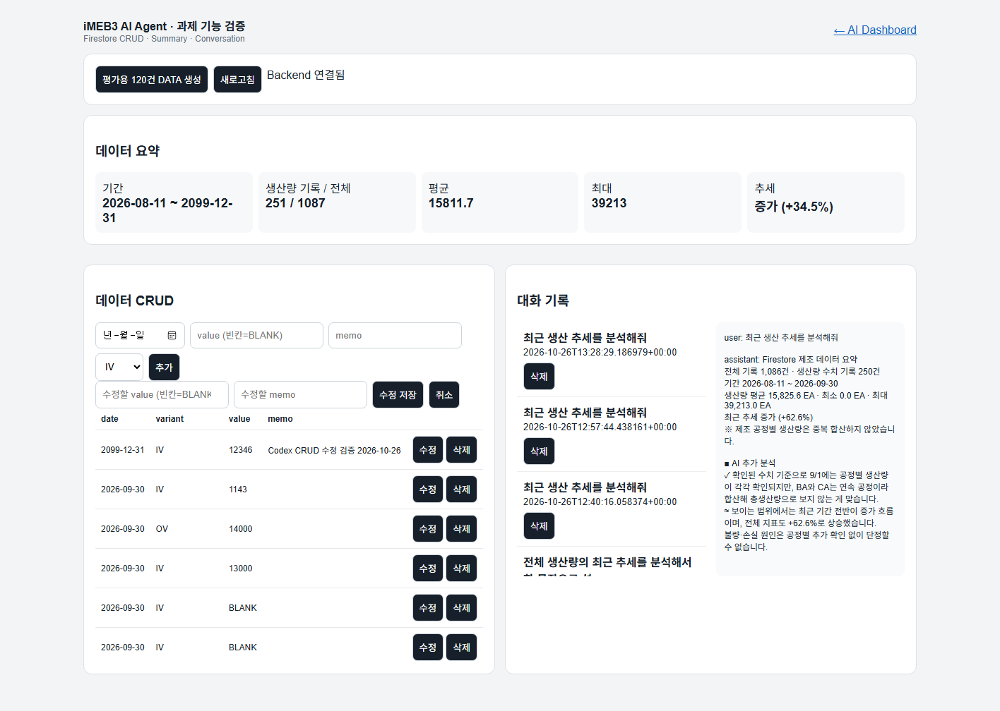
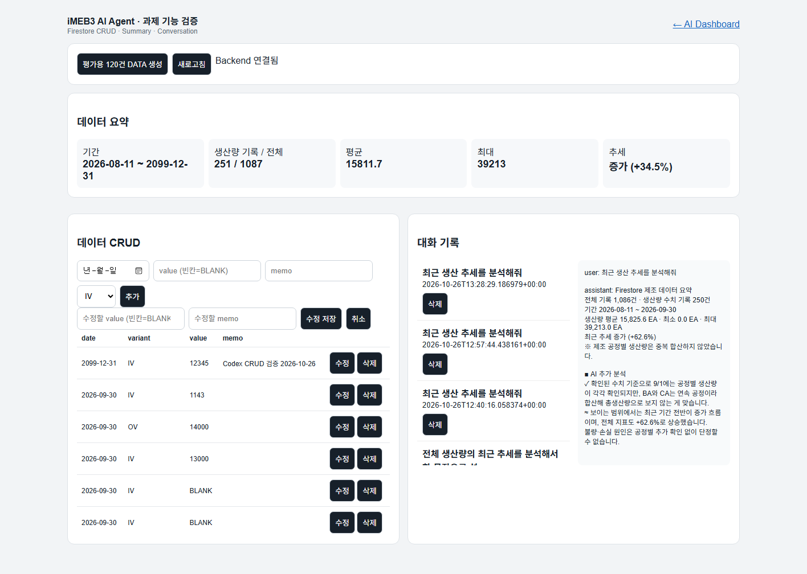
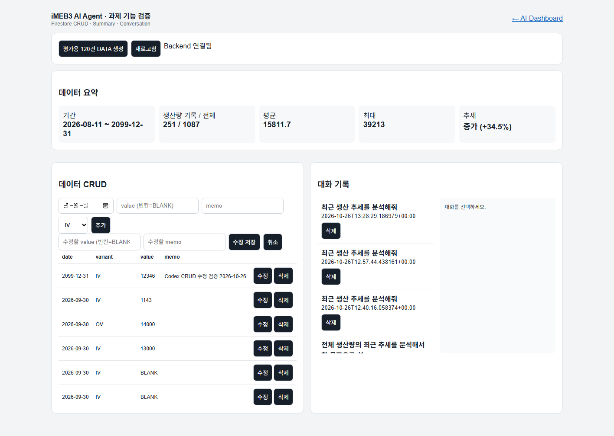
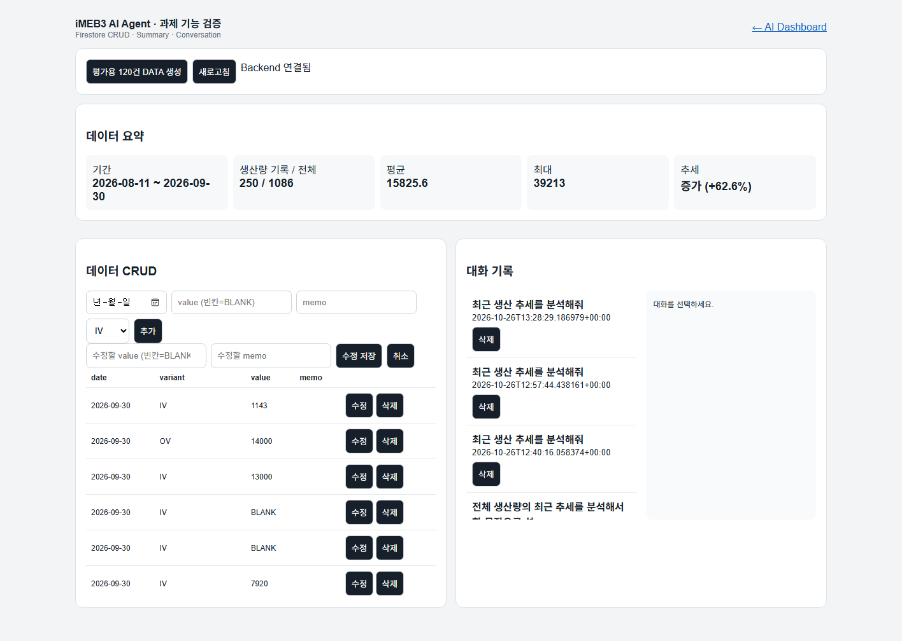
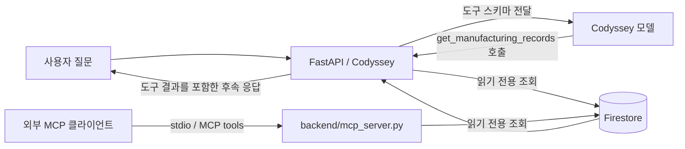
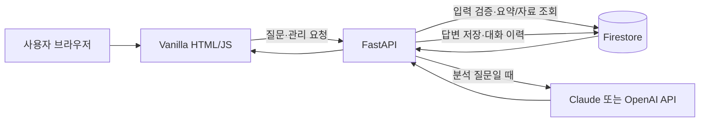

# iMEB3 제조 품질 AI Agent — 과제 제출용 v0.50.0

기존 iMEB3 v0.48 Manufacturing Intelligence를 과제 필수 요구사항에 맞게 완성한 버전입니다.
공개/평가 환경에서는 실제 회사 원본 대신 `POST /api/data/seed-demo`가 생성하는 **비식별 DEMO DATA 120건**을 사용합니다.

## 배포 주소

- 프론트엔드: [https://m1-2-frontend-dun.vercel.app](https://m1-2-frontend-dun.vercel.app)
- 실시간 상태 점검: [Render·CORS·Firestore 상태 페이지](https://m1-2-frontend-dun.vercel.app/status.html)
- 백엔드 API: [https://imeb3-ai-agent-api.onrender.com](https://imeb3-ai-agent-api.onrender.com)
- Render health: [Firestore 저장소·백업 상태 JSON](https://imeb3-ai-agent-api.onrender.com/api/health)
- Firestore 요약: [전체 건수·기간·통계 JSON](https://imeb3-ai-agent-api.onrender.com/api/data/summary)
- CORS·Firestore 빠른 확인: [브라우저 실시간 점검 페이지](https://m1-2-frontend-dun.vercel.app/status.html)
- Swagger: [https://imeb3-ai-agent-api.onrender.com/docs](https://imeb3-ai-agent-api.onrender.com/docs)
- 관리 화면: [https://m1-2-frontend-dun.vercel.app/manage.html](https://m1-2-frontend-dun.vercel.app/manage.html)
- 시연 전 Render 사전 준비 페이지: [https://m1-2-frontend-dun.vercel.app/warmup](https://m1-2-frontend-dun.vercel.app/warmup)

**2026-10-26 실시간 확인:** Render `/api/health`는 `storage=firestore`, `csv_fallback=false`를 반환했고 `/api/data/summary`는 전체 1,086건, 요약 대상 250건을 반환했습니다. 백업 상태는 배포 재시작 후 `not_run`으로 확인했습니다. CORS에서 로컬 대시보드 출처가 빠진 문제를 수정해 `localhost:5500`과 `127.0.0.1:5500`을 허용했고 Render 응답의 `Access-Control-Allow-Origin` 헤더를 확인했습니다. Vercel 브라우저에서 Codyssey 분석 채팅 성공, Firestore 대화 저장 및 재조회를 확인하고 임시 데이터 UI 추가·수정·삭제 후 기준 건수를 복구했습니다.

**최신 재확인 메모:** 보너스 기능 커밋 `c83129f` 배포 뒤 Vercel 관리 화면에서 새 기능 표시를 확인했습니다. 이후 Render `/api/health`는 Firestore 모드였지만 읽기 전용 `/api/data/summary`와 채팅 요청이 HTTP 503을 반환했습니다. 따라서 그 시점의 배포 Firestore/AI 기능은 정상이라고 단정하지 않으며, 할당량·백엔드 상태가 복구된 뒤 다시 확인해야 합니다.

2026-10-24 상태 기록은 당시 관측값입니다. 그날은 Firestore 일일 한도 제한으로 요약 조회가 실패했습니다. 2026-10-26 앞선 실행에서는 백업 `complete`도 확인했으며, 이후 Render 재시작 뒤 현재 health의 백업 상태는 `not_run`으로 보입니다.

로컬 `firestore_import` 백업의 읽기 전용 대체 경로는 2026-10-24 점검에서 CSV 변경자료 720건(생산량 요약 대상 187건)을 반환했습니다. 이는 Firestore 전체 스냅샷이 아니며 배포 서비스에는 포함되어 있지 않으므로, 배포 CRUD 검증이나 Firestore 전체 데이터 증빙으로 사용하지 않습니다.

## 과제 화면 캡처

### 2026-09-09 HSV 제조 흐름 질문

로컬 CSV 임시자료에서 `9/9 CA HSV` 질문으로 확인한 화면입니다. 답변과 그래프에 표시된 데이터는 CSV 임시자료 기반이며, Firestore 배포 연결의 증빙은 아닙니다.


### 제출 상태와 남은 확인

| 항목 | 현재 제출 자료 | 보완 상태 |
|---|---|---|
| 제조 질문·답변 및 LOT 그래프 | 위 로컬 화면 캡처 | CSV 임시자료 기반임을 캡션과 화면에 표시. Firestore 배포 증거로 사용하지 않음 |
| Render/Vercel 배포·CORS·Firestore 읽기 | 위 실시간 상태 점검 링크 | 2026-10-26 Render health, CORS 브라우저 요청, Firestore 요약 조회 성공 확인 |
| 데이터 추가·수정·삭제 | Vercel 관리 화면의 임시 Firestore 데이터 시연 | 아래 추가·수정·삭제 캡처. 종료 후 전체 1,086건/생산량 250건 복구 확인 |
| Codyssey 채팅·대화 불러오기 | Render 채팅 응답과 저장 대화 상세 재조회 | 아래 캡처 및 대화 ID `c25dfa44-0d83-435f-8376-7ff17471541a`; `ai_provider=CODYSAY_CHAT_COMPLETIONS` |
| 좁은 화면 사용성 | 390×844 모바일 화면 확인 | 한 열 배치와 화면 폭 내 레이아웃 확인. 긴 공정 흐름·LOT 그래프는 각 영역 안에서 가로 스크롤 |

### 최신 배포 기능 증빙

2026-10-26 Vercel 관리 화면에서 저장된 Codyssey 대화를 선택해 Firestore에서 전체 메시지를 다시 불러왔다. Render 채팅 응답은 `ai_provider=CODYSAY_CHAT_COMPLETIONS`, `storage=firestore`였고 대화 ID는 `c25dfa44-0d83-435f-8376-7ff17471541a`다.

연속 대화도 Render에서 확인했다. 대화 ID `6a63967d-a0a5-4f4e-8ba8-c324b0549cd4`에서 사용자가 정한 `파랑새-19` 별칭의 뜻을 후속 질문으로 물었고, Codyssey가 앞선 메시지를 기억해 답했다. 분석 키워드가 없는 질문이었으며 대화 ID가 유지되고 Firestore에 메시지 10개가 저장됐다. 이 검증 과정에서 발견한 대화 이력 전달 누락을 수정해 재배포한 뒤 성공 결과를 확인했다.

CRUD 화면에서 임시 `Codex CRUD 검증` 행을 추가하고 값 `12345`에서 `12346`으로 수정한 뒤 삭제했다. 삭제 후 임시 행이 사라지고 Firestore 기준 전체 1,086건, 생산량 250건과 요약 통계가 복구된 것을 확인했다.









## 구현 기능

- 데이터 기반 AI 채팅: `POST /api/chat`
  - Firestore/Memory의 관련 데이터 조회
  - `/api/data/summary`와 관련 데이터 Context 주입
  - `ANTHROPIC_API_KEY`가 설정되면 Claude Messages API 사용, 아니면 `OPENAI_API_KEY`로 OpenAI Responses API 사용
  - 키가 없거나 AI 호출 실패 시 Evidence 기반 fallback (없는 값 생성 금지)
  - 대화 자동 저장
- 데이터 CRUD
  - `POST /api/data`
  - `GET /api/data`
  - `PUT /api/data/{id}`
  - `DELETE /api/data/{id}`
  - `GET /api/data/summary`
- 대화 기록
  - `POST /api/conversations`
  - `GET /api/conversations`
  - `GET /api/conversations/{id}`
  - `DELETE /api/conversations/{id}`
- Firestore Adapter + 로컬 Memory fallback
- FastAPI Swagger `/docs`
- Vanilla HTML/CSS/JavaScript Frontend
- 기존 iMEB3 제조 Dashboard
- 데이터 CRUD / Summary / Conversation 관리 화면 (`manage.html`)
- Render / Vercel 배포 설정
- Render 시연 사전 기동 페이지 (`warmup.html`)
- Firestore 조회 성공 후 하루 1회 `data` 컬렉션 백업 스냅샷 (`daily_backups`, 기본 최근 7일)

## 보너스 기능

- **Function Calling:** Codyssey Chat Completions 요청에 `get_manufacturing_records` 읽기 전용 도구 스키마를 전달합니다. 모델이 날짜·제품 모델·공정을 지정해 도구를 호출하면 서버가 Firestore 기록을 조회하고 결과를 전달해 후속 답변을 생성합니다. 날짜와 허용 모델·공정 값을 검증하며, 실제 Codyssey 모델 도구 호출은 배포 검증 후 완료로 표시합니다.
- **MCP Server:** `backend/mcp_server.py`가 상태, Firestore 연결·기록 수, 제조 기록 조회 도구를 MCP stdio로 제공합니다. 로컬 MCP 클라이언트에서 실행하려면 Python 의존성을 설치하고 Firestore 서비스 계정 환경변수를 설정한 뒤 `python backend/mcp_server.py`를 command로 등록합니다. 서비스 계정 값은 클라이언트 설정 파일이나 저장소에 넣지 않습니다.
- **인사이트와 UX:** 관리 화면에서 생산량 중앙값을 표시하고 날짜별 IV/OV/HSV 생산량 라인 차트를 제공합니다. 조회된 데이터는 CSV 또는 JSON으로 다운로드할 수 있고 다크 모드를 전환할 수 있습니다. 관리 화면의 빈 데이터·API 오류 상태도 안내합니다.
- Dashboard 상단의 **관리 화면 열기** 링크는 관리 화면을 별도 탭으로 엽니다. 브라우저가 페이지 로드 시 자동 팝업을 차단하지 않도록 사용자가 누르는 바로가기로 제공합니다.
- 채팅 요청은 IP별 60초 창에 최대 20회로 제한하고, 질문·문맥·첨부 메타데이터 크기를 검증합니다. 외부 AI 요청은 30초 timeout, 1회 재시도와 출력 토큰 상한을 사용합니다. 요청 제한은 현재 프로세스 메모리 기반이므로 여러 인스턴스 간 공유 제한은 아닙니다.
- 배포 AI와 Firestore 점검은 일시적인 Firestore 503으로 완료하지 못한 시점이 있어, 원격 증빙이 필요한 항목은 복구 후 재검증합니다.

MCP 및 AI 조회 흐름:



실제 모델의 Function Calling 성공 및 외부 MCP 클라이언트의 연결·호출 결과는 보너스 제출 전에 별도 실연으로 기록합니다.

## 과제 발표용 동작 설명



- 사용자는 자연어로 제조 데이터를 질문하거나 관리 화면에서 기록을 다룹니다. 브라우저는 FastAPI에 요청하고, FastAPI가 Firestore에서 요약과 질문 관련 기록을 가져와 답변 근거로 사용합니다.
- Pydantic 요청 모델은 날짜 형식, 숫자, 제품 variant 등 입력을 서버 저장 전에 검사해 잘못된 값이 DB로 들어가는 것을 막습니다.
- OpenAI는 분석이 필요한 질문에만 추가 호출합니다. 서버는 제조 데이터 요약과 관련 근거를 함께 전달하며, 응답이 실패하면 근거 기반 대체 답변을 반환하고 실제 공급자 상태를 구분해 기록합니다.
- 질문과 답변은 `conversations`에 저장되어 관리 화면에서 대화를 선택하면 상세 API로 메시지를 다시 불러옵니다. `data`, `conversations`, `reviews`는 각각 Firestore 컬렉션의 문서로 저장됩니다.
- Firebase 서비스 계정과 AI API 키는 백엔드 환경 변수에만 둡니다. CORS는 `ALLOWED_ORIGINS`에 적힌 프론트 주소만 허용합니다.
- Render Free가 잠든 경우 `warmup.html`의 health 확인으로 시연 전에 먼저 기동할 수 있습니다. `/api/health`는 서버와 저장소 설정 상태를 확인하며, Firestore 자료 읽기 성공 여부는 별도의 데이터 API로 확인합니다.

## 과제용 100개 이상 시계열 데이터

백엔드 실행 후 Swagger 또는 관리화면에서:

```text
POST /api/data/seed-demo
```

을 한 번 실행하면 120건의 비식별 생산량 시계열이 생성됩니다.
실제 회사 생산실적이 아니며 `verification_status=DEMO_DATA`, `value_source=DERIVED`로 구분됩니다.

## 로컬 실행

### Backend

```bash
cd backend
python -m venv .venv
# Windows
.venv\Scripts\activate
pip install -r requirements.txt
copy .env.example .env
uvicorn app.main:app --reload
```

- API: `http://127.0.0.1:8000`
- Swagger: `http://127.0.0.1:8000/docs`

### Frontend

```bash
cd frontend
python -m http.server 5500
```

- Dashboard: `http://127.0.0.1:5500/index.html`
- CRUD/Summary/대화기록: `http://127.0.0.1:5500/manage.html`

## 환경 변수

Backend `.env`:

```text
ALLOWED_ORIGINS=http://localhost:5500,http://127.0.0.1:5500,https://YOUR-VERCEL-DOMAIN.vercel.app
FIREBASE_SERVICE_ACCOUNT_JSON={...서비스계정 JSON 전체...}
# 또는
FIREBASE_SERVICE_ACCOUNT_PATH=/path/to/serviceAccount.json
ANTHROPIC_API_KEY=
ANTHROPIC_MODEL=claude-sonnet-4-6
ANTHROPIC_MAX_OUTPUT_TOKENS=1000
# Claude 키가 없을 때 선택적으로 OpenAI 호환 경로 사용
OPENAI_API_KEY=...
OPENAI_BASE_URL=https://api.openai.com/v1
OPENAI_MODEL=gpt-5-mini
OPENAI_MAX_OUTPUT_TOKENS=2000
DAILY_BACKUP_RETENTION_DAYS=7
```

`ANTHROPIC_API_KEY`가 있으면 Claude가 우선 사용됩니다. 키는 백엔드 `.env` 또는 Render 비밀 환경변수에만 넣습니다. `ANTHROPIC_MODEL`과 출력 토큰 상한은 필요에 따라 조정합니다. Claude 키가 없으면 OpenAI 경로를 사용할 수 있습니다.

`DAILY_BACKUP_RETENTION_DAYS`는 Firestore의 앱 수준 일일 스냅샷 보관 일수이며 기본값은 7일입니다. 스냅샷은 Firestore 읽기 성공 후 하루에 한 번 생성됩니다.

복구할 때는 `backend` 폴더에서 `python restore_daily_snapshot.py YYYY-MM-DD`로 먼저 누락 문서 수를 미리 봅니다. 검토 후 `python restore_daily_snapshot.py YYYY-MM-DD --apply`를 실행하면 Firestore `data`에 현재 없는 문서만 생성합니다. 이미 있는 문서는 덮어쓰지 않습니다. 복원도 Firestore 쓰기 한도를 사용하므로 일일 한도 초기화 후 실행해야 합니다.

과제 원본은 OpenAI Responses API를 사용합니다. Claude를 선택한 경우 Anthropic Messages API를 직접 호출합니다. Render에는 `ANTHROPIC_API_KEY`를 비밀값으로 등록합니다. 기존 Codyssey 호환 경로는 `OPENAI_BASE_URL=https://copa.codyssey.kr/v1` 설정 때 사용됩니다. 실제 호출 지점은 `backend/app/main.py`의 `codysay_answer()`입니다.

Frontend / Vercel:

```text
API_BASE_URL=https://YOUR-RENDER-SERVICE.onrender.com
```

Vercel build 시 `build-config.mjs`가 환경변수를 `config.js`에 반영합니다.

## Firestore 컬렉션

- `data`: 시계열/제조 데이터
- `conversations`: AI 대화 기록
- `reviews`: 사람 판단/정정
- `daily_backups`: Render가 Firestore 데이터를 처음 성공적으로 조회할 때 날짜별 `data` 스냅샷을 하루 한 번 저장 (기본 7일 보관)

Render Free 인스턴스는 15분간 요청이 없으면 잠들고, 다음 HTTP 요청으로 깨어나는 데 약 1분 걸릴 수 있습니다. 발표/시연 약 1분 전에 `frontend/warmup.html`(다음 Vercel 배포 후 `/warmup.html`)을 열면 health 요청을 반복해 백엔드를 깨웁니다. 서버가 준비되면 선택적으로 Firestore 요약과 오늘 백업까지 확인할 수 있습니다. health 요청은 Firestore 문서를 읽지 않으며, 요약 버튼은 Firestore 읽기와 오늘 백업을 실행합니다.

오늘 첫 성공 데이터 조회 시 `data` 문서를 `daily_backups/{UTC날짜}/data/{해시 ID}`에 복사하고 완료 메타데이터를 기록합니다. 기본 보관은 최근 7일이며 오래된 스냅샷은 다음 백업 완료 뒤 정리합니다. 백업 실패는 원본 조회를 실패 처리하지 않고 health 상태와 Render 로그에 표시합니다. 이 앱 수준 스냅샷은 같은 Firestore 데이터베이스 안에 저장되므로 Firestore 일일 한도도 사용하고, 프로젝트/DB 전체 장애에 대비하는 독립 백업은 아닙니다. 별도 프로젝트나 Cloud Storage로 내보내는 관리형 백업은 Firebase 요금제 및 과금 조건을 확인한 뒤 별도로 설정해야 합니다.

## Render 배포

저장소 Root에 포함된 `render.yaml`을 사용할 수 있습니다.

- Root Directory: repository root (Blueprint 사용) 또는 Backend 직접 설정 시 `backend`
- Build: `pip install -r requirements.txt`
- Start: `uvicorn app.main:app --host 0.0.0.0 --port $PORT`
- Blueprint 생성 시 Firebase 서비스 계정 JSON, OpenAI API 키, `ALLOWED_ORIGINS`를 비밀 입력란에 설정 (`render.yaml`의 `sync: false`)
- OpenAI 기본 주소·모델·출력 토큰 수는 Blueprint에 정의되어 있음

배포 후 `https://<render-url>/docs`에서 Swagger를 확인합니다.
무료 인스턴스 사용 시 첫 요청은 콜드스타트로 지연될 수 있습니다.

## Vercel 배포

Vercel Framework Preset을 `Other`, Project Root를 `frontend`로 지정합니다.
환경변수 `API_BASE_URL`에 Render Backend URL을 입력합니다.
`vercel.json`의 `npm run build`가 배포 시 `config.js`를 생성하며, 정적 산출물은 `frontend` 루트입니다.

## 제출 시 확인 화면

1. AI Dashboard에서 질문 → 데이터 기반 답변 + 로딩 표시
2. `manage.html`에서 120건 Summary 확인 + 데이터 추가/삭제
3. AI 대화 후 `manage.html`에서 Conversation 선택 → messages 불러오기
4. Render `/docs` Swagger
5. README의 Frontend / Backend / Swagger 배포 URL 기입

## 보안

Git에 다음을 올리지 않습니다.

- `.env`
- Firebase 서비스 계정 JSON
- OpenAI API Key
- 실제 회사 작업일보/PDF/이미지
- 실제 생산 LOT 및 기밀 DB Backup

## v0.48에서 v0.50으로 추가된 내용

- OpenAI Responses API 실제 연동
- Summary Context Injection
- 120건 평가용 비식별 시계열 Seed
- Summary의 서로 다른 Metric 혼합 방지 (`PRODUCTION_QTY` 대표 시계열)
- CRUD/Summary/Firestore Conversation 관리 UI
- Render 설정
- Vercel 환경변수 기반 API URL 설정
- 과제 제출용 README / 환경변수 정리
